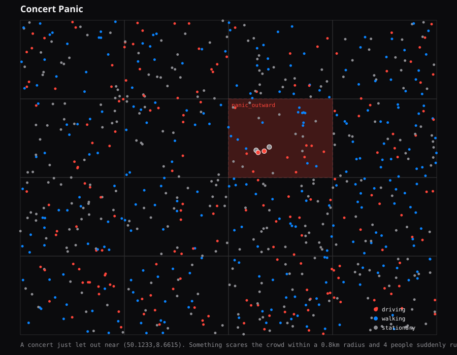

# Case: Concert Panic

A concert just let out near (50.1233,8.6615). Something scares the crowd within a 0.8km radius and 4 people suddenly run, 10-18 km/h, for about 27s.

Random seed: `50488760` (so this exact run can be reproduced)

- Ground-truth events: 1
- Detected: 0/1 (recall = 0%)
- Detection latency: n/a
- False positives during this run: 0

- `panic_outward` at (50.1233,8.6615), active 60s-87s -> **MISSED**

