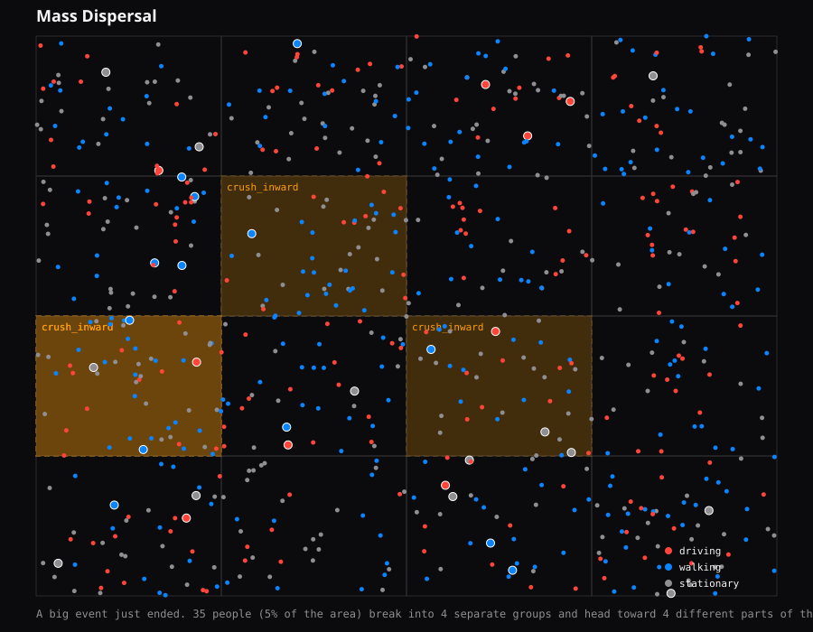

# Case: Mass Dispersal

A big event just ended. 35 people (5% of the area) break into 4 separate groups and head toward 4 different parts of the city at once (walking/transit pace), over about 46s.

Random seed: `540602159` (so this exact run can be reproduced)

- Ground-truth events: 4
- Detected: 0/4 (recall = 0%)
- Detection latency: n/a
- False positives during this run: 1

- `crush_inward` at (50.0671,8.6706), active 60s-106s -> **MISSED**
- `crush_inward` at (50.1145,8.6290), active 60s-106s -> **MISSED**
- `crush_inward` at (50.0905,8.5332), active 60s-106s -> **MISSED**
- `crush_inward` at (50.0970,8.5083), active 60s-106s -> **MISSED**

