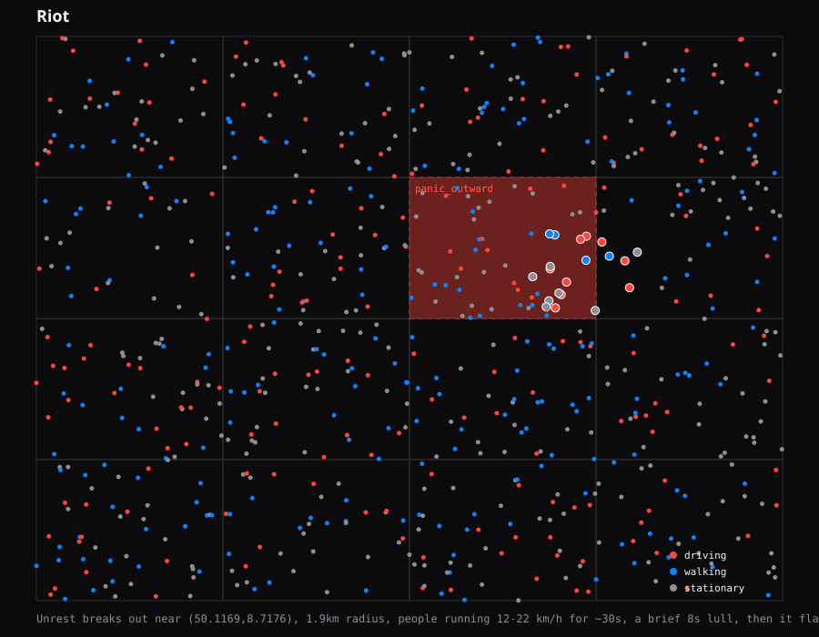

# Case: Riot

Unrest breaks out near (50.1169,8.7176), 1.9km radius, people running 12-22 km/h for ~30s, a brief 8s lull, then it flares up again nearby for ~32s.

Random seed: `558983632` (so this exact run can be reproduced)

- Ground-truth events: 2
- Detected: 0/2 (recall = 0%)
- Detection latency: n/a
- False positives during this run: 1

- `panic_outward` at (50.1169,8.7176), active 60s-90s -> **MISSED**
- `panic_outward` at (50.1167,8.7177), active 100s-134s -> **MISSED**

